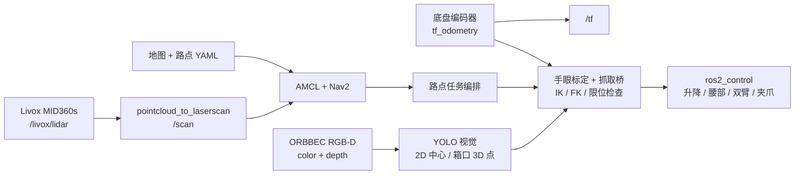

# Robot A 装配上料场景

> 基于 ROS 2 Humble 的双臂机器人视觉抓取、Nav2 导航与装配上料任务代码。


第二届世界机器人人形运动会装配上料场景代码。项目覆盖 ORBBEC 相机与 YOLO 视觉、Livox MID360s 建图/导航、AMCL 自动定位、双臂 IK 与 `ros2_control`、箱体搬运任务以及现场故障恢复。

<p>
  <a href="#quick-start">快速开始</a> ·
  <a href="#1-目录结构">目录结构</a> ·
  <a href="#4-业务代码用途">代码说明</a> ·
  <a href="#6-复现前提">复现前提</a> ·
  <a href="#8-首次复现流程">部署流程</a> ·
  <a href="#10-安全要求">安全须知</a>
</p>

## 项目速览

| 项目 | 说明 |
|---|---|
| 目标 | 箱体识别、双臂抓取、搬运、放置和释放 |
| 运行平台 | Ubuntu 22.04 / ROS 2 Humble / ARM64 或 Jetson |
| 感知设备 | ORBBEC RGB-D 相机、Livox MID360s |
| 导航栈 | AMCL、Nav2、SLAM Toolbox、`pointcloud_to_laserscan` |
| 操作层 | MoveIt 2、`ros2_control`、8 个机械臂/夹爪 Action |
| 任务入口 | 单任务 `m1_separate_vision_grasp_fixed.sh`；比赛任务 `competition_mission.sh` |

> [!IMPORTANT]
> 本仓库不是完整的 Robot A 运行镜像。复现还需要实机驱动、`robot_a_ws`、MoveIt 配置、视觉环境及与现场匹配的地图和手眼标定。

> [!NOTE]
> 本文档不包含 `20260116/` 文件夹。除该目录和 `.git` 元数据外，当前目录共有 551 个数据文件，约 864 MiB；其中大部分来自 Livox SDK 和构建产物。

## Quick Start

以下步骤只适用于已经具备完整 Robot A 实机环境的用户。首次运行前请阅读[复现前提](#6-复现前提)和[安全要求](#10-安全要求)。

> [!TIP]
> 第一次部署请先按[部署目录](#7-部署目录)复制文件并核对硬编码路径，不要直接在 Git 克隆目录运行启动脚本。

```bash
# 1. 启动底层硬件、相机、雷达、TF 和 /scan
cd /home/niic/Desktop
./all.sh

# 2. 检查关键话题和控制器
ros2 control list_controllers
ros2 topic hz /livox/lidar
ros2 topic hz /camera_head/color/image_raw

# 3. 完成视觉和抓取 dry-run 后，运行单任务
sudo -i
cd /home/niic/Desktop
./m1_separate_vision_grasp_fixed.sh
```

> [!WARNING]
> `enable_motion:=true`、`--execute` 和任务启动脚本都会控制真实机器人。首次运行必须完成第 8 节的 dry-run，并保持硬件急停可立即触发。

## 任务流程

```text
相机/雷达感知
    -> AMCL/Nav2 定位导航
    -> 箱口 3D 抓取点识别
    -> 双臂 IK/轨迹规划
    -> 抓取、抬升、搬运、放置、释放
    -> 关节归零或底盘纠错
```

最短使用路径是：先运行 `all.sh` 启动硬件和传感器，逐项确认雷达、相机、TF、Nav2 和机械臂控制器，再运行 `m1_separate_vision_grasp_fixed.sh` 或部署后的 `competition_mission.sh`。首次实机运动前必须完成 dry-run 检查。

## 1. 目录结构

| 目录 | 职责 |
|---|---|
| `competition/hand/` | MoveIt 归位、双臂 IK 与独立抓取 |
| `competition/vision/` | YOLO 模型、箱口 3D 识别、手眼标定和录制数据 |
| `competition/wheel/` | 底盘命令、建图工具和 Livox MID360s 驱动 |
| `map/` | 栅格地图和任务路点 |
| `onemission/` | AMCL 自动定位和单个巡逻路点控制 |
| `package/` | 单任务与四轮比赛任务的部署包 |

<details>
<summary><strong>展开完整目录树</strong></summary>

```text
xiangmuzhi/
├── README.md
├── .gitignore
├── all.sh
├── robot_a_oneclick_start.sh
├── m1_separate_vision_grasp_fixed.sh
├── yaokong.txt
├── competition/
│   ├── 命令文档.txt
│   ├── shi yong .txt
│   ├── hand/
│   │   ├── robot_a_moveit_home_oneclick_v2.py
│   │   ├── reset.txt
│   │   ├── README_robot_A_grasp_latest.md
│   │   ├── task1_box/
│   │   │   ├── final_.py
│   │   │   └── final_lift.py
│   │   └── task2_/
│   │       └── ik_grasp_dual_mirror_real_v4.py
│   ├── vision/
│   │   ├── screw_ros2.py
│   │   ├── tanhuang_ros2.py
│   │   ├── multibox_ros2 .py
│   │   ├── process_3d.py
│   │   ├── record_video.py
│   │   ├── models/
│   │   ├── recordings/
│   │   ├── rgbd_recordings/
│   │   ├── box/
│   │   │   ├── box_ros2/
│   │   │   ├── box_bridge/
│   │   │   ├── 1/
│   │   │   ├── box_waypoint_mission.py
│   │   │   ├── box_dual_arm_grasp_v9_template10_shoulder007_prelift025.py
│   │   │   ├── box_dual_arm_place_height_constrained_v4_smooth.py
│   │   │   ├── box_dual_arm_release_outward_3cm.py
│   │   │   └── box_all_joints_zero.py
│   │   ├── tanhuangbag/
│   │   └── transformation matrix/
│   └── wheel/
│       ├── daohang.txt
│       ├── jiantu.txt
│       ├── livox_ws/
│       │   ├── config/
│       │   ├── install/
│       │   ├── sdk2_install/
│       │   ├── src/livox_ros_driver2/
│       │   └── vendor/Livox-SDK2/
│       ├── robot_a_mapping_tools/
│       └── vendor_backup/
├── map/
│   ├── robot_a_site_raw.yaml
│   ├── robot_a_site_raw.pgm
│   ├── real_waypoints.yaml
│   └── real_waypoints_2.yaml
├── onemission/
│   ├── auto_global_localization.py
│   ├── auto_global_localizationprevious.py
│   └── navigate_first_patrol_waypoint.py
└── package/
    ├── m1.sh
    ├── box_waypoint_mission.py
    ├── box_grasp_bridge_mirror_vision_raw_prelift025.py
    ├── bridge_xyz_offset_box_wide_descend_postlift_large_skew_v5_far_fast.py
    ├── bridge_xyz_offset_box_wide_descend_postlift_large_skew_v7_lateral_out3cm_descend_finalz.py
    └── competition_mission/
        ├── competition_mission.py
        ├── competition_mission.sh
        ├── box_waypoint_mission.py
        ├── bridge_xyz_offset_box_wide_descend_postlift.py
        ├── competition_waypoints.yaml
        └── README.md
```

</details>

`competition/wheel/livox_ws/` 中约 400 个文件来自 Livox SDK、ROS 驱动源码、示例程序和 colcon 构建结果，不是业务任务代码。

## 2. 系统组成



主要 ROS 接口：

| 接口 | 用途 |
|---|---|
| `/cmd_vel` | Nav2 原始速度输出 |
| `/box_mission/nav_cmd_vel` | 任务节点接收的导航速度 |
| `/box_mission/manual_cmd_vel` | 视觉纠错和人工辅助移动 |
| `/mecanum_drive_controller/reference_unstamped` | 麦克纳姆轮底盘最终速度 |
| `/scan` | 雷达点云转换后的二维激光 |
| `/map` | SLAM/Nav2 地图 |
| `/amcl_pose` | AMCL 定位和协方差 |
| `/joint_states` | 实机关节反馈 |
| `/box_detection/*` | 箱体 2D/3D 检测结果 |
| `/box_grasp_point/*` | 箱口左右 3D 抓取点 |
| `/box_grasp/*` | 抓取状态和完成信号 |

## 3. 根目录文件

| 文件 | 用途 |
|---|---|
| `.gitignore` | 排除 `20260116/`、两个大型 RGB-D 数据包、Python 缓存和构建日志。 |
| `all.sh` | 10 标签底层启动器：机械臂 EtherCAT、底盘、MoveIt、相机、雷达、TF 和点云转激光。还会清理旧 Nav2 并等待关键进程就绪。 |
| `robot_a_oneclick_start.sh` | 精简底层启动器，只打开机械臂 EtherCAT、底盘和 MoveIt 三个标签。 |
| `m1_separate_vision_grasp_fixed.sh` | 单场景五标签主工作流：Nav2、速度仲裁、自动定位、RViz、箱体任务。使用两个抓取点和两个抬升高度。 |
| `yaokong.txt` | 手动遥控、相机、雷达、视觉和各类抓取流程的命令备忘。 |

## 4. 业务代码用途

<details>
<summary><strong>展开各模块文件说明</strong></summary>

### 4.1 机械臂与独立抓取

| 文件 | 用途 |
|---|---|
| `competition/hand/robot_a_moveit_home_oneclick_v2.py` | 使用 MoveIt 将升降、腰部和双臂归零；默认实际执行，`--dry-run` 只规划。 |
| `competition/hand/reset.txt` | 机械臂归位的检查与运行命令。 |
| `competition/hand/task1_box/final_.py` | 双臂固定点抓取控制器，使用 FK、数值 IK、关节模板和真实 `ros2_control` Action；默认 dry-run。 |
| `competition/hand/task1_box/final_lift.py` | `final_.py` 的升降增强/历史版本。 |
| `competition/hand/task2_/ik_grasp_dual_mirror_real_v4.py` | 左右机械臂镜像运动、右夹爪抓取的纯 IK 版本。 |
| `competition/hand/README_robot_A_grasp_latest.md` | 双臂抓取原理、控制器、坐标转换、安全检查和操作流程。 |

注意：根目录抓取 README 中提到的
`dual_arm_fixed_grasp_xy_lift_squeeze_raise_real.py` 不在当前仓库中；实际对应实现应查看 `task1_box/final_.py` 或 `task1_box/final_lift.py`。

### 4.2 视觉检测

| 文件 | 用途 |
|---|---|
| `competition/vision/box/box_ros2/box_ros2_open_rim_corner_midpoints_3d_geomselect.py` | 箱口 YOLO Pose 节点。拟合箱口平面，将四个像素关键点反投影成 3D 点，再计算左右短边中点。 |
| `competition/vision/box/box_ros2/box_ros2_robust.py` | 在上述节点上增加多箱目标选择，优先中央区域和较近目标。 |
| `competition/vision/screw_ros2.py` | 螺钉袋 YOLO 2D 检测，发布中心像素、有效标志和可视化图像。 |
| `competition/vision/tanhuang_ros2.py` | 弹簧 YOLO 2D 检测，结构与螺钉节点相同，模型为 `tanhuang.pt`。 |
| `competition/vision/multibox_ros2 .py` | 多箱检测复制版，默认模型路径为 `models/multi_box.pt`。当前仓库没有该模型，且文件名在 `.py` 前含有空格。 |
| `competition/vision/process_3d.py` | 离线 YOLO Pose 数据处理工具，读取彩色/深度 PNG 并输出 3D 短边中点 CSV。不是 ROS 在线节点。 |
| `competition/vision/record_video.py` | ROS 2 同步记录彩色图、深度图和元数据。 |

模型目录：

| 文件 | 用途 |
|---|---|
| `models/box.pt` | 箱体 Pose/检测模型，主箱体流程使用。 |
| `models/screw.pt` | 螺钉袋检测模型。 |
| `models/tanhuang.pt` | 弹簧检测模型。 |
| `models/best.pt` | 历史 Pose 模型；当前业务代码没有直接引用，离线 `process_3d.py` 使用的是其自身写死的外部路径。 |
| `rgbd_recordings/multiscrew.zip` | 261 组彩色/深度帧和 1 个 `metadata.csv`。 |
| `rgbd_recordings/single_box.zip` | 211 组彩色/深度帧和 1 个 `metadata.csv`。 |
| `recordings/` | 两段调试视频及 28 张抽帧。 |

### 4.3 箱体抓取与搬运

| 文件 | 用途 |
|---|---|
| `box_waypoint_mission.py` | 通用路点任务节点。负责 Nav2 Action、视觉启动、抓取、升降、放置、释放、归零、TF 稳定、代价地图刷新和底盘纠错。 |
| `box_waypoint_mission_previous.py` | 较短的旧任务节点。 |
| `box_waypoint_mission_separate_vision_grasp_fixed.py` | 视觉常驻、抓取独立等待触发、抓取后可靠续跑路点的修正版。 |
| `box_dual_arm_grasp_v9_template10_shoulder007_prelift025.py` | 双臂抓取基础控制器，包含 FK、IK、模板约束、共享 lift 和 Action 执行。 |
| `box_grasp_bridge_mirror_vision_raw_prelift025.py` | 视觉抓取桥接层，将相机 3D 点经手眼标定和 TF 转换为双臂目标。 |
| `box_grasp_bridge_asymmetric_staged_avoidance.py` | 非对称分阶段抓取避障路径。 |
| `box_grasp_bridge_asymmetric_staged_sharedlift_xyzfix.py` | 在非对称路径上修正共享升降和 XYZ 一致性。 |
| `bridge_xyz_guard.py` | 夹爪闭合验证和保护层。 |
| `bridge_xyz_offset_box.py` | 偏置夹箱 IK 基础层。 |
| `bridge_xyz_offset_box_common_height.py` | 统一箱口高度和自适应偏置路径。 |
| `bridge_xyz_offset_box_wide_descend_postlift.py` | 宽位下降、低位内收、夹紧、验证和抓后抬升。 |
| `...large_skew_v2.py` 至 `...v7...finalz.py` | 针对大倾斜、远目标、路径连续性、关节跳变等问题逐步迭代的抓取版本。当前单任务脚本选择 V7。 |
| `box_dual_arm_place_height_constrained_v4_smooth.py` | 平滑移动夹持中的箱体到指定 TCP 高度；默认不松爪。 |
| `box_dual_arm_release_outward_3cm.py` | 先张开夹爪，再让左右手各向外退约 3 cm；默认 dry-run。 |
| `box_dual_arm_release_outward_3cm_v2_fixed.py` | 对任意实际抓取姿态放宽前臂水平条件的释放修正版。 |
| `box_all_joints_zero.py` | 平滑归零 16 个运动关节和双夹爪。 |

`box_bridge/` 是抓取实现依赖目录。`box/1/` 和 `CODE.zip` 是历史快照/备份；不同目录中存在大量完全相同的 Python 文件，修改算法前必须先确认启动脚本实际加载的是哪一份。

`box_bridge/previous_mirror/` 中的版本属于历史实验分支：

- `...v5_force_workspace.py`：强制大偏置并明确报告工作空间失败。
- `...v6_center_guess.py`：使用目标中心横向偏移生成快速初始候选。
- V2-V4 同名文件是这些实验依赖的旧副本。

### 4.4 弹簧/螺钉袋抓取

| 文件 | 用途 |
|---|---|
| `competition/vision/tanhuangbag/screw_grasp_bridge_v11_grasp_verify_retry.py` | 完整视觉闭环。将 2D 中心像素、深度点云、TF 和右臂手眼标定组合成抓取目标；夹取后验证，失败则回安全高度重试。 |
| `competition/vision/tanhuangbag/ik_grasp_dual_mirror_real_v9_grasp_verify_retry.py` | 镜像双臂抓取控制器，先 XY 后 Z，支持夹取验证。 |
| `competition/vision/tanhuangbag/spring_raise_to_1p7_and_left_reverse_zero_v9_1_pitch_root_continuous_safe_fixed.py` | 抓取后升到约 1.7 m，保持右夹爪，并沿安全路径将左臂反序归零。 |
| `competition/vision/tanhuangbag/111.txt` | 相机、视觉、抓取和抬升的现场命令。 |

部署风险：V11 默认的 `ik_script_path` 是
`/home/niic/Desktop/competition/vision/ik_grasp_dual_mirror_real_v4.py`，
该文件不在当前仓库的对应位置。需要将 `competition/hand/task2_/ik_grasp_dual_mirror_real_v4.py`
部署到该路径，或者通过 ROS 参数覆盖 `ik_script_path`。

### 4.5 手眼标定

| 文件 | 用途 |
|---|---|
| `transformation matrix/30_left.calib` | 左臂 eye-on-base 手眼标定。 |
| `transformation matrix/eob_calib_left_20260805.calib` | 较新的左臂 eye-on-base 标定。 |
| `transformation matrix/eob_calib_right.calib` | 右臂 eye-on-base 标定。 |
| `transformation matrix/biaoding.txt` | AprilTag、`easy_handeye2` 和相机坐标检查命令。 |

标定值仅对应当前相机安装、头部姿态和机械臂结构。重新拆装相机或机械臂后必须重新标定。

### 4.6 导航、定位与建图

| 文件 | 用途 |
|---|---|
| `onemission/auto_global_localization.py` | AMCL 自动全局定位 V2.3。自动重初始化，左右交替旋转，根据位置/航向协方差判断成功，失败可重试。 |
| `onemission/auto_global_localizationprevious.py` | 旧 V2.1 版本，只重初始化一次。 |
| `onemission/navigate_first_patrol_waypoint.py` | 启动巡逻服务，只执行第一个 `NavigateToPose` 目标，然后停止 patrol 并取消后续目标。 |
| `map/real_waypoints.yaml` | 单任务使用的两个抓取点路线。 |
| `map/real_waypoints_2.yaml` | 完整的四个抓取点路点备份。 |
| `map/robot_a_site_raw.yaml` | Nav2 地图配置，分辨率 0.05 m，原点 `[-29.9, 2.41, 0]`。 |
| `map/robot_a_site_raw.pgm` | 414×354 灰度栅格地图。 |
| `competition/wheel/robot_a_mapping_tools/robot_a_mapping.sh` | 建图会话管理器，支持 `start/status/save/stop/restart`。 |
| `competition/wheel/robot_a_mapping_tools/robot_a_mapping_使用说明.md` | 建图和保存地图说明。 |
| `competition/wheel/daohang.txt` | 导航、旧节点清理、TF 检查和速度转发命令。 |
| `competition/wheel/jiantu.txt` | 建图、遥控和地图保存命令。 |

### 4.7 Livox MID360s 雷达

| 路径 | 用途 |
|---|---|
| `competition/wheel/livox_ws/config/MID360S_front_config.json` | MID360s 网络配置：雷达 `192.168.11.2`，主机 `192.168.11.101`。 |
| `competition/wheel/livox_ws/setup_livox_env.sh` | 加载 Livox 工作空间、SDK 动态库和 ROS 环境。 |
| `competition/wheel/livox_ws/src/livox_ros_driver2/` | ROS 2 驱动源码，包括回调、通信、配置解析、点云/IMU 发布和 launch。 |
| `competition/wheel/livox_ws/vendor/Livox-SDK2/` | Livox 底层 SDK，包括设备管理、命令协议、数据接收、升级和官方 samples。 |
| `competition/wheel/livox_ws/sdk2_install/` | SDK 安装结果，包含 3 个头文件和动态/静态库。 |
| `competition/wheel/livox_ws/install/` | colcon 构建产物和 ROS 环境脚本。 |
| `competition/wheel/vendor_backup/` | ARM64 预编译库、vendor 源码包和 `file_report.txt`、`ldd_report.txt` 诊断资料。 |

`install/`、`sdk2_install/lib/` 和 `vendor_backup/` 中部分文件是构建产物。不要把 Windows 或不同 Ubuntu 版本下生成的库直接复制到目标机，优先在目标机重新编译。

### 4.8 打包与比赛任务

| 文件 | 用途 |
|---|---|
| `package/m1.sh` | 旧的单任务五标签部署脚本，使用单个抬升高度。 |
| `package/box_waypoint_mission.py` | 恢复版通用任务节点部署副本。 |
| `package/competition_mission/competition_mission.py` | 正式比赛入口，继承通用任务节点并循环执行四组 `grabN -> dropN`。 |
| `package/competition_mission/box_waypoint_mission.py` | 比赛包使用的底层任务节点。 |
| `package/competition_mission/bridge_xyz_offset_box_wide_descend_postlift.py` | 比赛抓取桥接层，额外包含基于 IK 和底盘小步移动的工作空间恢复。 |
| `package/competition_mission/competition_mission.sh` | 五标签比赛启动器。 |
| `package/competition_mission/competition_waypoints.yaml` | 比赛路线：`start -> point1 -> point2 -> 四组 grab/drop -> point2 -> point1 -> start`。 |
| `package/competition_mission/README.md` | 比赛包的原始部署说明。 |

</details>

## 5. 启动入口之间的关系

### 5.1 底层硬件启动

```text
all.sh
  ├─ 机械臂 EtherCAT
  ├─ 底盘 EtherCAT
  ├─ MoveIt
  ├─ Orbbec 相机
  ├─ Livox MID360s
  ├─ 轮速 TF relay
  ├─ base_link -> base_footprint
  └─ /livox/lidar -> /scan
```

`robot_a_oneclick_start.sh` 是精简版，只启动机械臂、底盘和 MoveIt，不包含相机、雷达、TF 和 `/scan`。

### 5.2 单任务入口

```text
m1_separate_vision_grasp_fixed.sh
  -> box_waypoint_mission.py
  -> box_ros2_robust.py
  -> V7 bridge_xyz_offset_box_wide_descend_postlift...
  -> place_height_constrained_v4_smooth.py
  -> release_outward_3cm.py
  -> all_joints_zero.py
```

常用配置：

- 抓取点：`grab1`、`grab3`
- 抬升点：`mid1`、`mid3`
- 抬升高度：`0.90 m`、`0.50 m`
- 最终点：`end`

### 5.3 比赛四轮入口

```text
package/competition_mission/competition_mission.sh
  -> competition_mission.py
  -> package/competition_mission/box_waypoint_mission.py
  -> package/competition_mission/bridge_xyz_offset_box_wide_descend_postlift.py
  -> 四组 grab1/drop1 ... grab4/drop4
```

`competition_mission.py` 没有复制底层控制逻辑，而是继承底层任务节点并替换路线。因此修复视觉、导航或底盘恢复问题时，应优先修改比赛包实际使用的底层文件。

不要同时运行 `m1`、`competition_mission.sh` 和 `real_robot_patrol.launch.py`。它们都会控制导航或底盘，多个任务节点并发发送 `NavigateToPose` 或速度会产生冲突。

## 6. 复现前提

### 6.1 必须存在的实机组成部分

本仓库不包含完整的 Robot A 基础工作空间。要复现，还需要现场提供：

1. Robot A 的上层 EtherCAT 和底盘驱动。
2. `robot_a_ws` 中的 `robot_a_real_navigation`、`robot_a_moveit_config` 和机器人描述/URDF。
3. `/opt/robot/current/bin/ros2env` 机器人厂商 ROS 环境。
4. `activate_box_pose.sh` 视觉 Python 环境，包含与 `cv_bridge` 兼容的 NumPy 1.x。
5. Orbbec 相机驱动和 `/camera_head/*` 话题。
6. Livox MID360s 及 `/livox/lidar` 点云。
7. 8 个机械臂 Action 控制器和 `/joint_states`。
8. 与当前相机、头部和双臂匹配的手眼标定。
9. 与现场一致的 Nav2 地图和路点。

启动脚本还引用了 `20260116/test_robot_A`、`/home/niic/robot_a_ws`、`/home/niic/mojl_robotA` 等外部路径。仅复制本仓库无法完成全部复现。

### 6.2 软件依赖

- Ubuntu 22.04
- ROS 2 Humble
- Nav2、AMCL、SLAM Toolbox
- MoveIt 2
- ros2_control 和 controller_manager
- `topic_tools`
- `tf2_ros`
- `pointcloud_to_laserscan`
- `apriltag_ros`
- `easy_handeye2`
- Python 3.10、`rclpy`、`cv_bridge`
- `ultralytics`、PyTorch、OpenCV、NumPy 1.x、SciPy
- Orbbec 相机驱动和 Livox MID360s 驱动

建议在机器人厂商提供的 ROS 环境中安装依赖。不同 JetPack、ROS 和 PyTorch 版本可能造成 TensorRT、CUDA、`cv_bridge` 或 NumPy ABI 不兼容。

## 7. 部署目录

### 7.1 单任务部署

建议保持启动脚本中的默认路径：

```text
competition/       -> /home/niic/Desktop/competition/
map/               -> /home/niic/Desktop/map/
onemission/        -> /home/niic/Desktop/onemission/
all.sh             -> /home/niic/Desktop/all.sh
robot_a_oneclick_start.sh
                   -> /home/niic/Desktop/robot_a_oneclick_start.sh
m1_separate_vision_grasp_fixed.sh
                   -> /home/niic/Desktop/m1_separate_vision_grasp_fixed.sh
```

设置权限：

```bash
chmod +x /home/niic/Desktop/m1_separate_vision_grasp_fixed.sh
chmod +x /home/niic/Desktop/competition/wheel/robot_a_mapping_tools/robot_a_mapping.sh
```

如果修改了目录，需要同步修改 `m1_separate_vision_grasp_fixed.sh` 顶部变量：

```bash
ROS_ENV="/opt/robot/current/bin/ros2env"
ROBOT_WS="/home/niic/robot_a_ws/install/setup.bash"
BOX_DIR="/home/niic/Desktop/competition/vision/box"
WAYPOINT_FILE="/home/niic/Desktop/map/real_waypoints.yaml"
MAP_FILE="/home/niic/Desktop/map/robot_a_site_raw.yaml"
BOX_POSE_ACTIVATE="/root/activate_box_pose.sh"
```

### 7.2 比赛四轮部署

比赛包自身的设计是公共底层覆盖和独立路线入口。复制前先备份原文件。

```bash
cd /path/to/xiangmuzhi/package/competition_mission
BOX_DST="/home/niic/Desktop/competition/vision/box"
BRIDGE_NAME="bridge_xyz_offset_box_wide_descend_postlift.py"

# 1. 任务节点放到 box 根目录
cp competition_mission.py "$BOX_DST/"
cp box_waypoint_mission.py "$BOX_DST/"

# 2. 备份并替换抓取桥，使同目录依赖仍可导入
cp "$BOX_DST/box_bridge/$BRIDGE_NAME" \
  "$BOX_DST/box_bridge/$BRIDGE_NAME.bak"
cp "$BRIDGE_NAME" "$BOX_DST/box_bridge/"

# 3. 路点放到 Nav2 工作空间的配置目录
cp competition_waypoints.yaml \
  /home/niic/robot_a_ws/src/robot_a_real_navigation/config/

# 4. 启动脚本放到桌面
cp competition_mission.sh /home/niic/Desktop/
chmod +x /home/niic/Desktop/competition_mission.sh
```

比赛抓取桥依赖 `box_bridge/` 中的
`bridge_xyz_offset_box.py`、`bridge_xyz_offset_box_common_height.py`
等文件。为避免自动搜索同时找到多个同名桥接脚本，推荐将比赛桥接文件放入并替换
`box/box_bridge/` 中的同名文件，然后在 `competition_mission.sh` 顶部显式配置：

```bash
GRASP_SCRIPT="/home/niic/Desktop/competition/vision/box/box_bridge/bridge_xyz_offset_box_wide_descend_postlift.py"
```

不要只把桥接文件放到 `box/` 根目录而不配置依赖路径，否则其中的
`bridge_xyz_offset_box_common_height` 可能无法导入。

比赛脚本顶部还有地图占位符，启动前必须修改：

```bash
MAP_FILE="/home/niic/maps/robot_a_site_raw.yaml"
```

如果保留 `MAP_FILE="__MAP_FILE__"`，脚本会在启动运动链之前主动退出。

## 8. 首次复现流程

以下流程假定所有硬件驱动和外部 ROS 包已经安装完成。首次运行必须有人守在实体急停旁。

### 8.1 检查 ROS 环境

```bash
source /opt/ros/humble/setup.bash
source /opt/robot/current/bin/ros2env
source /home/niic/robot_a_ws/install/setup.bash
```

检查视觉环境：

```bash
source /root/activate_box_pose.sh
python3 -c "import numpy, cv2, torch, ultralytics; print(numpy.__version__)"
```

视觉脚本要求主版本为 NumPy 1.x。

### 8.2 检查地图、路点和标定

```bash
ls -lh /home/niic/Desktop/map/
ls -lh "/home/niic/Desktop/competition/vision/transformation matrix/"
```

确认：

- YAML 中的 `image` 指向真实 PGM。
- 路点坐标与当前场地一致。
- 左右手眼标定文件不是旧机器人的数据。
- 地图原点和实际场地一致。

场地变化后应重新建图：

```bash
sudo bash /home/niic/Desktop/competition/wheel/robot_a_mapping_tools/robot_a_mapping.sh start
sudo bash /home/niic/Desktop/competition/wheel/robot_a_mapping_tools/robot_a_mapping.sh status
sudo bash /home/niic/Desktop/competition/wheel/robot_a_mapping_tools/robot_a_mapping.sh save robot_a_site_raw
sudo bash /home/niic/Desktop/competition/wheel/robot_a_mapping_tools/robot_a_mapping.sh stop
```

### 8.3 启动底层硬件

从普通桌面用户运行：

```bash
cd /home/niic/Desktop
./all.sh
```

如果现场只需要机械臂、底盘和 MoveIt，可使用：

```bash
./robot_a_oneclick_start.sh
```

启动后等待对应标签页稳定，检查：

```bash
ros2 node list
ros2 action list | grep -E 'controller|follow_joint_trajectory|gripper_cmd'
ros2 topic list | grep -E '/joint_states|/livox/lidar|/camera_head'
ros2 control list_controllers
```

### 8.4 检查传感器和 TF

```bash
ros2 topic hz /livox/lidar
ros2 topic hz /camera_head/color/image_raw
ros2 run tf2_ros tf2_echo odom base_link
ros2 run tf2_ros tf2_echo base_link livox_frame
ros2 run tf2_ros tf2_echo base_link camera_head_link
```

再用 `rqt_image_view` 检查相机图像。确认没有旧定位、旧 Nav2 或重复 TF 发布者。

### 8.5 单独测试视觉

```bash
cd /home/niic/Desktop/competition/vision/box/box_ros2
source /root/activate_box_pose.sh
python3 box_ros2_robust.py --ros-args \
  -p target_center_band_ratio:=0.25 \
  -p target_depth_roi_scale:=0.50 \
  -p target_depth_percentile:=30.0
```

另一个终端检查：

```bash
ros2 topic echo /box_detection/valid --once
ros2 topic echo /box_grasp_point/valid --once
ros2 run rqt_image_view rqt_image_view
```

必须看到稳定的 `valid=true` 和合理的左右 3D 抓取点。

### 8.6 单独测试抓取规划

先关闭 `enable_motion`，只检查 IK、关节限位和路径：

```bash
cd /home/niic/Desktop/competition/vision/box/box_bridge
source /opt/robot/current/bin/ros2env
source /home/niic/robot_a_ws/install/setup.bash

python3 box_grasp_bridge_mirror_vision_raw_prelift025.py \
  --ros-args \
  -p enable_motion:=false \
  -p velocity_scale:=0.20
```

确认：

- 8 个控制器全部在线。
- `/joint_states` 包含全部 16 个运动关节。
- 左右抓取点通过工作空间和关节限位检查。
- XY、Z、前臂倾角、夹爪竖直和关节跳变均在容忍范围内。

任一项失败都不要直接改成 `enable_motion:=true`。

### 8.7 测试抬升、释放和归零

先做 dry-run：

```bash
python3 box_dual_arm_place_height_constrained_v4_smooth.py \
  -z 0.70 \
  --velocity-scale 0.30

python3 box_dual_arm_release_outward_3cm.py \
  --retreat-cm 3.0 \
  --velocity-scale 0.30
```

确认轨迹后再考虑添加 `--execute`。释放脚本会张爪并要求机械臂外退，必须先保证箱体已经由放置面承重。

### 8.8 运行单任务

确认底层硬件、传感器、Nav2、地图、视觉环境和机械臂控制器均正常后：

```bash
sudo -i
cd /home/niic/Desktop
./m1_separate_vision_grasp_fixed.sh
```

脚本会打开五个 root 标签页：

1. Nav2 和初始 RViz
2. Nav2 速度接入仲裁
3. AMCL 自动全局定位
4. 刷新 RViz
5. 箱体路点任务

观察 `/robot_a/box_mission/state`、`/robot_a/box_mission/current_waypoint`
和 `/robot_a/box_mission/completed` 判断任务进度。

### 8.9 运行比赛四轮路线

完成比赛包部署、抓取脚本绝对路径配置和地图占位符替换后：

```bash
sudo -i
cd /home/niic/Desktop
./competition_mission.sh
```

比赛路线：

```text
start -> point1 -> point2
-> grab1 -> drop1 -> grab1 退回
-> grab2 -> drop2 -> grab2 退回
-> grab3 -> drop3 -> grab3 退回
-> grab4 -> drop4 -> grab4 退回
-> point2 -> point1 -> start
```

退回抓取点时只导航，不重复抓取。

## 9. 关键配置

### 9.1 路点

`map/real_waypoints.yaml` 是单任务路线；`package/competition_mission/competition_waypoints.yaml` 是四轮比赛路线。

每个路点包含：

```yaml
object_id: grab1
dock_pose: [x, y, yaw]
dwell_seconds: 5.0
```

任务节点按 YAML 顺序执行，所以修改顺序会直接改变任务路线。

### 9.2 模型

视觉节点的默认模型路径都是部署后的绝对路径：

```text
/home/niic/Desktop/competition/vision/models/box.pt
/home/niic/Desktop/competition/vision/models/screw.pt
/home/niic/Desktop/competition/vision/models/tanhuang.pt
```

如果移动模型，需要修改节点默认参数，或用 `--ros-args -p model_path:=...` 覆盖。

### 9.3 速度

主要速度变量包括：

- `velocity_scale`：机械臂 Action 轨迹速度比例。
- `VISION_SCAN_SPEED`：视觉扫描时的角速度。
- `NAV_STUCK_*`：导航卡住判断参数。
- `FINE_ALIGNMENT_*`：接近抓取点时的低速微调参数。

首次复现应使用低速度，确认方向和轨迹后再放大。

## 10. 安全要求

> [!CAUTION]
> 本项目控制真实双臂机器人。任何 `/execute`、`enable_motion:=true` 或任务启动脚本都可能立即驱动机械臂、夹爪和底盘。必须在人员撤离、急停可触达、路径已验证的条件下运行。

1. 第一次运行必须进行 dry-run。
2. 必须先做无负载路径测试，再进行夹持测试。
3. 实机运行时急停必须可以立即触发。
4. 机器人周围不能有人；操作者不要进入机械臂运动范围。
5. 必须确认箱体、桌面、人体的几何关系和线缆走向。
6. 必须在启动前确认没有其他节点控制相同的 8 个机械臂 Action。
7. 必须确认夹爪闭合后不会夹到人员、箱体边缘或线缆。
8. 必须确认抬升后不会碰撞顶部障碍物。
9. 实机运动脚本的 `--execute` 表示允许真实运动，不是模拟模式。
10. `Ctrl+C` 只请求取消轨迹，不等同于硬件急停。

部分工作空间检查、IK 和夹爪验证不能替代真实碰撞检测和受力检测。

## 11. 常见问题

### 启动提示找不到脚本

检查 `m1_separate_vision_grasp_fixed.sh` 或
`competition_mission.sh` 顶部变量，确认目录与实机部署目录一致。

### 启动提示找到多个抓取脚本

自动搜索会在 `BOX_DIR` 下寻找同名文件。直接将 `GRASP_SCRIPT`
设置为唯一的绝对路径，推荐使用 `box_bridge/` 中的版本。

### 视觉节点启动后没有结果

检查：

```bash
ros2 topic hz /camera_head/color/image_raw
ros2 topic hz /camera_head/depth/points
ros2 topic echo /camera_head/color/camera_info --once
```

同时检查模型路径、相机内参、点云坐标系和 `valid` 话题。

### 相机和点云时间不同步

先确认 Orbbec 驱动是否发布同步后的 RGB/Depth/PointCloud；不要直接关闭点云同步检查，否则抓取点可能来自不同场景帧。

### Nav2 动作不可用

检查：

```bash
ros2 action list | grep navigate
ros2 node list | grep -E 'bt_navigator|planner_server|controller_server'
ros2 lifecycle get /bt_navigator
ros2 topic echo /amcl_pose --once
```

### 导航卡住或目标频繁 ABORTED

检查 `/local_costmap`、`/global_costmap`、TF 稳定性和底盘速度仲裁。当前任务节点会自动清理代价地图，并支持小步底盘纠错，但不能修复地图错误或传感器失效。

### 自动定位一直旋转

检查：

```bash
ros2 topic echo /amcl_pose --once
ros2 run tf2_ros tf2_echo odom base_link
```

常见原因是地图与场地不一致、初始地图原点错误、雷达 `/scan` 不稳定或 AMCL 参数与地图分辨率不匹配。

### 夹爪 Action 成功但箱子没有夹住

检查 `/joint_states`、夹爪位置/努力反馈、`bridge_xyz_guard.py` 的验证输出以及箱体两侧接触点。Action 成功只表示控制器完成命令，不表示物体已经可靠夹住。

## 12. 已知问题与仓库限制

1. `multibox_ros2 .py` 默认引用的 `models/multi_box.pt` 不存在。
2. `process_3d.py` 含 Windows 绝对路径和固定相机内参，只适合原始离线数据环境。
3. `competition/hand/README_robot_A_grasp_latest.md` 引用了当前不存在的旧文件名。
4. `screw_grasp_bridge_v11...py` 的默认 IK 脚本路径需要按实际部署覆盖。
5. `competition_mission.sh` 的 `MAP_FILE` 必须手工替换。
6. `box/1/`、`box_bridge/`、`CODE.zip` 和 `package/` 中存在多份重复源码。
7. 两个大型 RGB-D ZIP 被 `.gitignore` 排除，可能没有同步到远程仓库。
8. 预编译 `.so` 和 `.a` 是 Linux ARM64/aarch64 产物，可能依赖目标机的 ROS、Python 和 OpenCV ABI。
9. 完整 Robot A 驱动、MoveIt 配置、Nav2 包和 `20260116/test_robot_A` 工作空间不在本目录范围内。
10. 当前仓库没有包含自动化实机测试，所有验证仍需在目标机器人上完成。

## 13. 修改代码时的定位建议

| 需求 | 优先检查 |
|---|---|
| 修改抓取点或任务顺序 | `map/*.yaml`、`package/competition_mission/competition_waypoints.yaml` |
| 修改底盘导航 | `robot_a_ws` 中的 Nav2 配置，不在本仓库 |
| 修改自动定位 | `onemission/auto_global_localization.py` |
| 修改视觉目标选择 | `competition/vision/box/box_ros2/box_ros2_robust.py` |
| 修改箱口 3D 几何 | `competition/vision/box/box_ros2/box_ros2_open_rim_corner_midpoints_3d_geomselect.py` |
| 修改抓取路径和 IK | `competition/vision/box/box_bridge/` 中实际启动的 V7 文件及其父类 |
| 修改箱体放置高度 | `box_dual_arm_place_height_constrained_v4_smooth.py`、任务脚本中的 `LIFT_HEIGHT_*` |
| 修改释放距离 | `box_dual_arm_release_outward_3cm.py` |
| 修改机械臂归零 | `box_all_joints_zero.py`、`robot_a_moveit_home_oneclick_v2.py` |
| 修改比赛四轮流程 | `package/competition_mission/competition_mission.py` |
| 修改相机手眼关系 | `competition/vision/transformation matrix/*.calib` |
| 修改雷达网络 | `competition/wheel/livox_ws/config/MID360S_front_config.json` |

修改抓取相关文件时，务必确认启动脚本实际使用的是哪份副本。当前仓库保留了多个开发阶段版本，同名文件并不一定等价。

## License

当前仓库未声明开源许可证。在重新分发或用于其他项目之前，请联系项目维护者确认授权范围。

---

<p align="right">
  <a href="#robot-a-装配上料场景">返回顶部 ↑</a>
</p>
